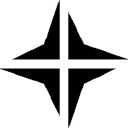

<p align="center">
  <picture>
    <source
      srcset=".github/assets/logo.png"
      media="(prefers-color-scheme: light), (prefers-color-scheme: no-preference)"
    />
    <source
      srcset=".github/assets/logo-white.png"
      media="(prefers-color-scheme: dark)"
    />
    
  </picture>
</p>

# Xray Gateway

Xray Gateway routes selected IPv4 traffic from a RouterOS network through VLESS
REALITY profiles. A web panel manages profiles, IP lists, users and health checks.

Use a Linux Docker host connected to the client network. Configure the network
addresses and parent interface in `.env`; the project has no dependency on a
particular LAN, host name or reverse proxy. Docker Desktop and rootless Docker
do not provide the required macvlan data path.

## Features

- Profile priorities, health checks and automatic selection of a healthy route.
- Traffic counters, live charts and per-profile statistics.
- Mixed IPv4/IPv6 address lists and scoped RouterOS script generation.
- Administrator and operator accounts, password changes and CSRF protection.
- Four interface styles, each with light and dark modes.

The transparent VPN path supports IPv4. IPv6 entries export to RouterOS address
lists; this version does not route IPv6 through the VPN. If no enabled profile
passes its health checks, the gateway uses the direct connection.

<details>
  <summary>Web themes</summary>

| Theme   | Screenshot                                                                   |
| ------- | ---------------------------------------------------------------------------- |
| Titan   |      |
| Paper   |      |
| Console |  |
| Contour |  |

</details>

## Quick start

Requirements: Linux, rootful Docker Engine, Docker Compose 2.36 or newer, and
Python 3.12 or newer for the setup command. Reserve a free LAN address for the
gateway outside your DHCP pool.

```sh
git clone https://github.com/QueenDekim/XRay-gateway.git
cd XRay-gateway
cp .env.example .env
```

Edit `.env` for your network, then create the first administrator password:

```sh
python3 scripts/configure.py
docker compose up -d --build
docker compose ps
```

Open `http://<GATEWAY_IP>:<PANEL_PORT>`, sign in with `ADMIN_USERNAME` and the
password you entered, and add a VLESS profile. Add an IP list and generate its
RouterOS script after checking the [routing instructions](docs/routeros.md).

## Documentation

The [documentation index](docs/README.md) covers installation, network drivers,
configuration, RouterOS preparation, panel/API use, backups and troubleshooting.
Read [deployment](docs/deployment.md) before changing a production router.

## NetLens

[NetLens](https://github.com/QueenDekim/NetLens) discovers domain addresses and
captures application connections on Windows. It has its own repository,
dependencies and releases. The optional `tools` Git submodule pins a NetLens
revision:

```sh
git submodule update --init tools
```

The gateway runs without the submodule. Import a NetLens `ips.txt` export through
the panel when you need its results in an IP list.

## Development and license

See [CONTRIBUTING.md](CONTRIBUTING.md) for tests and contribution guidelines,
[SECURITY.md](SECURITY.md) for reporting vulnerabilities, and
[CHANGELOG.md](CHANGELOG.md) for changes.

Project code uses [Apache-2.0](LICENSE). Dependencies retain the licenses listed
in [THIRD_PARTY_NOTICES.md](THIRD_PARTY_NOTICES.md).
