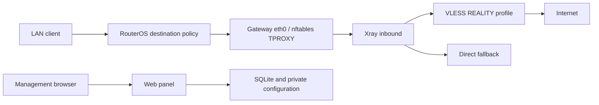

# Architecture

The gateway and Xray services share network and PID namespaces. The supervisor
creates policy-routing and nftables rules inside that namespace, probes local
HTTP inbounds and selects the first healthy enabled profile by priority. It
records traffic through the local Xray statistics API.

Each profile has dedicated inbounds and a connection mark. The supervisor keeps
old marks associated with their profile slots while a profile remains present;
it does not reuse deleted slots for unrelated profiles. Management traffic and
private destinations bypass interception.

The panel and health server run in the gateway process. The panel stores
profiles, statistics, settings and lists in `panel.sqlite`. `auth.json` contains
account hashes and revisions. Xray reads `config.json` from a read-only directory
mount. The application validates a candidate configuration before replacing it
and restores the previous configuration if applying a profile fails.

The optional management bridge gives a reverse proxy a separate path. Compose
keeps its route priority below the macvlan/ipvlan data plane. The gateway and Xray services
do not mount the Docker socket or change the host firewall.

## Management pages and updates

The HTTP server authenticates document requests before rendering the shared
shell with one page. It embeds a sanitized state snapshot for that page. The
standalone sign-in document handles password and two-factor authentication;
protected pages contain no sign-in form.

The gateway checks GitHub tags and both GHCR image digests. It writes validated
update requests to the shared `updates-control` volume. The updater service
owns the Docker socket and launches a detached worker, so restarting the three
Compose services does not terminate installation. The worker preserves the
project's Compose files and network identities, backs up runtime state, then
checks the new version and health. It restores the old images and data if those
checks fail. See [Updates](updates.md) for scope and recovery.
